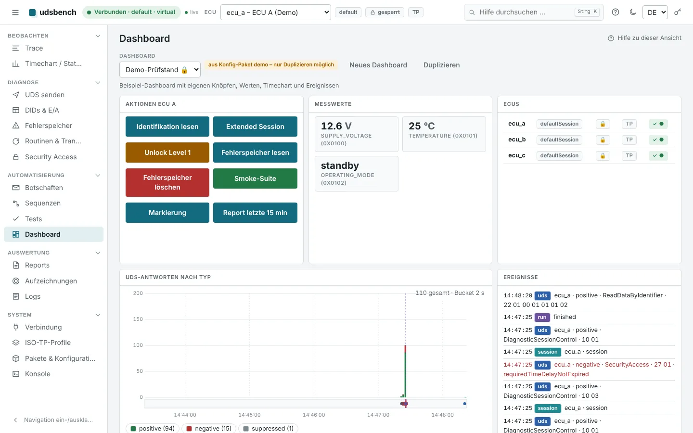
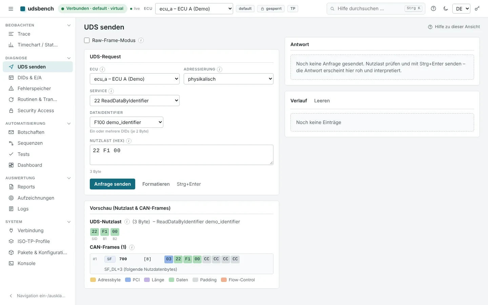
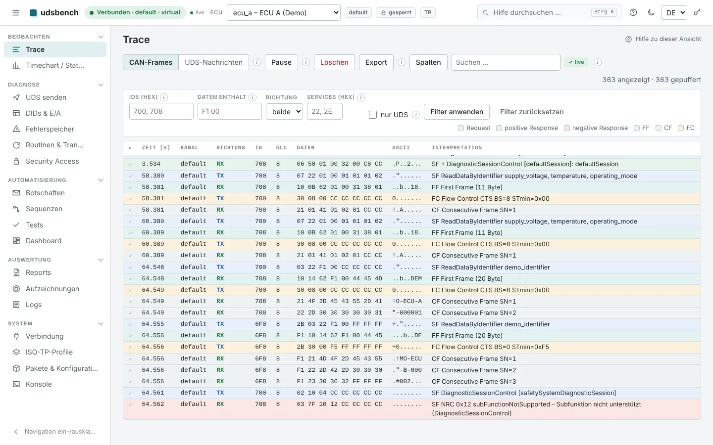
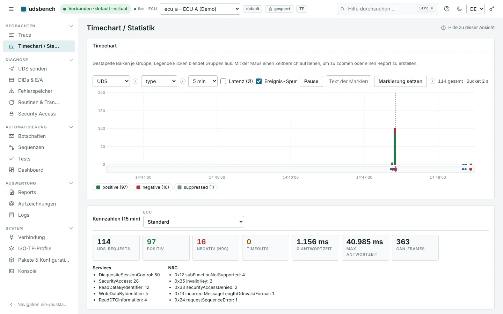
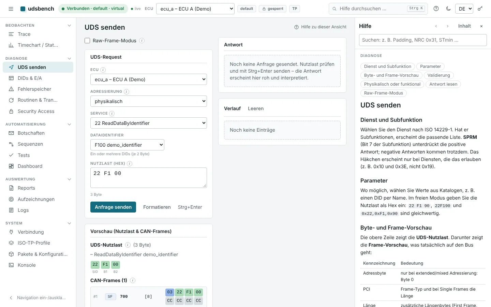
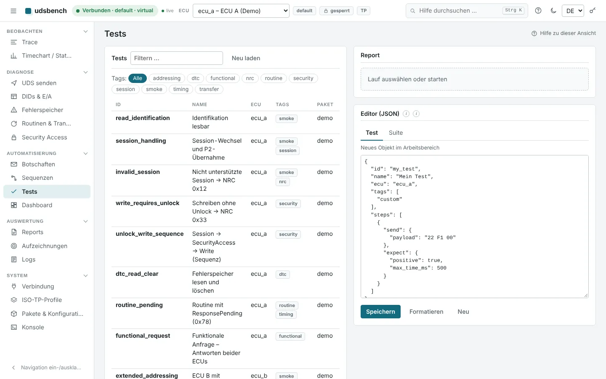
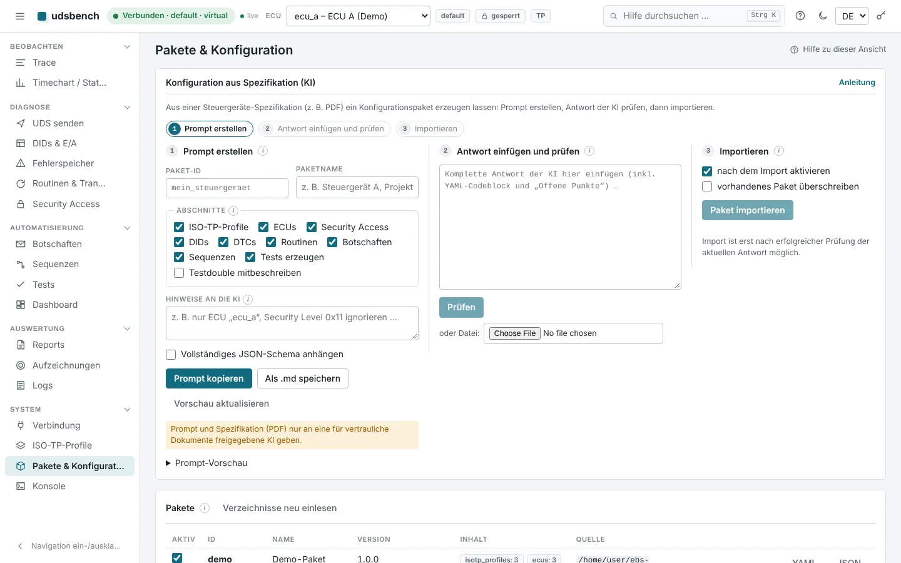

# udsbench

**Diagnose- und Testwerkzeug für UDS über CAN – im Browser, ohne Hardware sofort startklar.**

udsbench beobachtet, sendet und testet Diagnosekommunikation nach **ISO 14229** (UDS) und
**ISO 15765-2** (ISO-TP). Es läuft lokal auf Windows, Linux und macOS, mit echter CAN-Hardware über
[python-can](https://python-can.readthedocs.io) oder ganz ohne: Ein virtueller Bus mit simulierten
Steuergeräten ist eingebaut. Das Werkzeug ist herstellerneutral. Alles Gerätespezifische steht in
Konfigurationsdateien, nicht im Code.




> **Hinweis zur Entstehung:** Dieses Projekt wurde vollständig von einer KI (Claude, Anthropic)
> erstellt – Code, Tests und Dokumentation. Es ist durch automatisierte Tests abgesichert, aber nicht
> unabhängig zertifiziert. Details: [AI_DISCLOSURE.md](AI_DISCLOSURE.md).

> **Sicherheit:** Diagnosebefehle können das Verhalten von Steuergeräten verändern (Reset,
> Ein-/Ausgänge steuern, Speicher schreiben, Programmieren). Verwenden Sie udsbench an realen
> Fahrzeugen und sicherheitsrelevanten Systemen nur am Prüfstand oder im abgesicherten Stillstand
> und auf eigene Verantwortung. Siehe [Haftung](#haftung).

## Inhalt

[Schnellstart](#schnellstart) · [Was udsbench kann](#was-udsbench-kann) · [Screenshots](#screenshots) ·
[Installation](#installation) · [Echte Hardware](#echte-hardware-anbinden) ·
[Eigene Steuergeräte](#eigene-steuergeräte-konfigurieren) · [Automatisierung](#automatisierung-per-api) ·
[Dokumentation](#dokumentation) · [Entwicklung](#entwicklung) · [Lizenz](#lizenz) · [English](#english)

## Schnellstart

Voraussetzung: Python 3.11 oder neuer. Node.js und npm werden **nicht** benötigt – die gebaute
Oberfläche liegt im Repository.

```bash
git clone https://github.com/hackobert/udsbench.git && cd udsbench
python -m venv .venv
source .venv/bin/activate            # Windows: .venv\Scripts\activate
pip install .
udsbench run --demo --open
```

Der Browser öffnet <http://127.0.0.1:8765/>. Mit `--demo` ist ein virtueller Bus mit drei
simulierten Steuergeräten verbunden. Probieren Sie:

1. **UDS senden** → Dienst *ReadDataByIdentifier*, DID *demo_identifier* → **Strg+Enter**.
   Die Vorschau zeigt, welche CAN-Frames auf den Bus gehen.
2. **Trace** → alle Frames live, farbig nach Bedeutung, mit Klartext.
3. **Tests** → Suite *Smoke-Test* starten und den Report öffnen.
4. **F1** → Hilfe zur aktuellen Ansicht.

Die API-Dokumentation zum Ausprobieren liegt unter <http://127.0.0.1:8765/docs>.

## Was udsbench kann

| Bereich | Funktionen |
|---|---|
| **Beobachten** | Live-Trace mit Frames und zusammengesetzten UDS-Nachrichten, Filter, Lesezeichen · Timechart mit Ereignis-Spur · Aufzeichnung und Replay (ASC, CSV, candump, JSONL) |
| **Diagnose** | 27 UDS-Dienste mit Subfunktionen, vollständige NRC-Tabelle · Byte- und Frame-Vorschau mit PCI, Adressbyte und Padding · DIDs typgerecht lesen/schreiben · Fehlerspeicher mit Statusbits · Routinen · Download/Upload · Security Access mit austauschbaren Providern |
| **Automatisieren** | vordefinierte Botschaften mit Platzhaltern · Sequenzen mit Bedingungen und Schleifen · deklarative Tests (YAML) mit Assertions und Datensätzen · NRC-Provokationssuite · Dashboards mit eigenen Knöpfen |
| **Auswerten** | Reports als JSON, JUnit-XML, HTML oder ZIP mit Traces und Logs · Reports über frei wählbare Zeitbereiche · strukturierte Logs mit Korrelations-ID, Audit-Log |
| **Konfigurieren** | Konfig-Pakete (YAML/JSON) mit Schema-Prüfung · **KI-Assistent**: Prompt erzeugt aus einer Spezifikation ein importierbares Paket |
| **Plattform** | Windows, Linux, macOS · ein Prozess · REST- und WebSocket-API · integrierte, durchsuchbare Hilfe |

**Normtreue.** ISO-TP und UDS sind gegen ein simuliertes Steuergerät getestet: alle
Adressierungsarten (Längenbyte an der richtigen Position), Padding-Varianten (`00`/`AA`/`CC`/`FF`,
feste oder minimale DLC, CAN-FD), Flow Control, STmin im µs-Bereich, P2/P2\*, 0x78,
TesterPresent/S3, SPRMIB und funktionale Anfragen. Siehe [docs/conformance.md](docs/conformance.md).

## Screenshots

| | |
|---|---|
|  **UDS senden** mit Byte- und Frame-Vorschau |  **Live-Trace** mit Klartext |
|  **Timechart** und Kennzahlen |  **Kontexthilfe** (F1) |
|  **Tests**, Suiten und Läufe |  **KI-Assistent** für Konfigurationen |

Die Oberfläche folgt der Systemeinstellung für hell und dunkel ([Beispiel](docs/images/uds-dark.webp)).

## Installation

| System | Hinweise |
|---|---|
| **Linux** | `python3 -m venv .venv && . .venv/bin/activate && pip install .` |
| **Windows** | `py -3.12 -m venv .venv && .venv\Scripts\activate && pip install .` – Treiber des CAN-Adapters laut python-can-Doku installieren |
| **macOS** | `python3 -m venv .venv && source .venv/bin/activate && pip install .` |

Die gebaute Oberfläche ist in `backend/udsbench/static/` eingecheckt und wird von `pip install .`
mitinstalliert – für Installation, Wheel und Ein-Datei-Build ist kein Node.js/npm nötig. Es genügt
ein Prozess: `udsbench run`. Nur wer die Oberfläche selbst ändert, braucht Node.js 20+ (siehe
[Entwicklung](#entwicklung)).

* **Konfiguration:** `udsbench init` legt `config/app.yaml` an (Vorlage: [config/app.example.yaml](config/app.example.yaml)).
* **Ein-Datei-Build (optional):** `pip install ".[build]" && pyinstaller packaging/udsbench.spec`.
  Beachten Sie die Hinweise zu python-can in [THIRD_PARTY_NOTICES.md](THIRD_PARTY_NOTICES.md).
* **Befehle:** `udsbench run`, `validate`, `schema`, `init`, `ai-prompt`, `ai-check` (`udsbench --help`).

## Echte Hardware anbinden

Interface, Kanal und Bitrate kommen aus der Konfiguration oder werden in der Ansicht *Verbindung*
gewählt. Jedes von python-can unterstützte Interface funktioniert.

```yaml
# config/app.yaml
connections:
  - {name: default, backend: python-can, options: {interface: socketcan, channel: can0, bitrate: 500000}}
```

Unter Linux vorher: `sudo ip link set can0 up type can bitrate 500000`.
CAN-FD: zusätzlich `fd: true` und `data_bitrate`. Mehrere Kanäle gleichzeitig sind möglich.

## Eigene Steuergeräte konfigurieren

Steuergeräte, CAN-IDs, Adressierung, Padding, Sessions, Security, Kataloge, Botschaften und Tests
stehen in **Konfig-Paketen**:

```yaml
isotp_profiles:
  target:
    tx_id: 0x700
    rx_id: 0x708
    addressing: extended            # Byte 0 = Zieladresse, Längenbyte in Byte 1
    tx_address_extension: 0x2B
    padding: {enabled: true, byte: 0xFF}
    dlc_mode: fixed                 # immer volle 8 Byte
```

* **Beispiel:** [config/packages/demo.example.yaml](config/packages/demo.example.yaml) · **Vorlage:** [config/templates/real_ecu.template.yaml](config/templates/real_ecu.template.yaml)
* **Aus einer Spezifikation per KI:** *Pakete & Konfiguration → Konfiguration aus Spezifikation (KI)*
  erzeugt einen Prompt, der zusammen mit dem Spezifikations-PDF an eine KI geht. Die Antwort wird
  geprüft (bei Fehlern mit Korrektur-Prompt) und importiert. → [docs/ai-config.md](docs/ai-config.md)
* **Security Access:** Das Tool enthält keine Seed-to-Key-Verfahren. Eigene Verfahren werden als
  Bibliothek, Skript oder Python-Datei angebunden. → [docs/security-providers.md](docs/security-providers.md)

Eigene Pakete und Provider-Dateien sind per `.gitignore` vom Repository ausgeschlossen.

## Automatisierung per API

Alles, was die Oberfläche kann, geht auch per REST-API – zum Beispiel ein kompletter Testlauf in der CI:

```bash
udsbench run --demo --no-browser &
python examples/run_suite.py --suite full --junit report.xml   # Exit-Code 0 = bestanden
```

```bash
curl -s -X POST localhost:8765/api/v1/uds/request \
     -H 'Content-Type: application/json' -d '{"ecu":"ecu_a","payload":"22 F1 00"}'
```

Token für Fernzugriff: `UDSBENCH_TOKEN`. Routen, WebSockets und Fehlerformat: [docs/api.md](docs/api.md).

## Dokumentation

| Thema | Datei |
|---|---|
| Architektur | [docs/architecture.md](docs/architecture.md) |
| Konfig-Pakete, Schritte, Tests | [docs/configuration.md](docs/configuration.md) |
| Konformität ISO 14229 / 15765-2 | [docs/conformance.md](docs/conformance.md) |
| Security Access und Provider | [docs/security-providers.md](docs/security-providers.md) |
| Reports, Timechart, Dashboards | [docs/reports-dashboards.md](docs/reports-dashboards.md) |
| Konfiguration aus Spezifikation per KI | [docs/ai-config.md](docs/ai-config.md) |
| API und Automatisierung | [docs/api.md](docs/api.md) · [examples/](examples) |
| Designentscheidungen | [docs/decisions.md](docs/decisions.md) |

Die Bedienhilfe ist in die Oberfläche eingebaut (F1, Strg+K) und liegt als Markdown in
[backend/udsbench/help/de/](backend/udsbench/help/de).

## Projektstruktur

```
backend/udsbench/   Python-Paket: can, isotp, uds, config, messages, testrunner, security,
                    simulation, reports, dashboards, help, api, server.py, cli.py
backend/tests/      Unit-, Konformitäts-, Integrations- und API-Tests (pytest)
frontend/           Browser-Oberfläche (TypeScript, Vite, ohne Laufzeitabhängigkeiten)
config/             Beispielkonfiguration, Demo-Paket, Vorlagen für Pakete und Provider
docs/               Dokumentation und Screenshots
examples/           API-Beispiele (curl, Python, CI)
packaging/          Ein-Datei-Build (PyInstaller)
```

## Entwicklung

```bash
pip install -e ".[dev]"
pytest                                   # Backend-Tests inkl. Konformitäts-Suite
ruff check backend && ruff format --check backend && mypy
cd frontend && npm ci && npm run lint && npm test && npm run build
cd frontend && npm run dev               # Entwicklungsserver mit Proxy auf Port 8765
```

Nach Änderungen in `frontend/` den Build (`npm run build`) mit committen: Der Inhalt von
`backend/udsbench/static/` ist versioniert, damit sich udsbench ohne Node.js bauen lässt. Die CI
prüft, dass er zum Quellcode passt.

Beiträge sind willkommen – bitte [CONTRIBUTING.md](CONTRIBUTING.md) lesen. Grundregel: keine
hersteller- oder gerätespezifischen Daten im Code. Sicherheitsprobleme bitte privat melden:
[SECURITY.md](SECURITY.md). Änderungen: [CHANGELOG.md](CHANGELOG.md).

## Haftung

udsbench wird ohne jede Gewährleistung bereitgestellt (siehe [LICENSE](LICENSE)). Es ist kein
zertifiziertes Werkzeug und ersetzt weder Werkstatt- noch Hersteller-Diagnosesysteme. Die Nutzung
an Fahrzeugen, Bremsen, Lenkungen oder anderen sicherheitsrelevanten Systemen erfolgt auf eigene
Verantwortung und nur unter geeigneten Sicherheitsvorkehrungen.

## Lizenz

[MIT](LICENSE). Abhängigkeiten stehen unter eigenen Lizenzen, darunter python-can unter LGPL-3.0:
[THIRD_PARTY_NOTICES.md](THIRD_PARTY_NOTICES.md). ISO 14229 und ISO 15765 werden nur mit ihrer
Nummer genannt; udsbench enthält keine Normtexte und steht in keiner Verbindung zu ISO oder zu
Fahrzeug- oder Geräteherstellern.

## English

**udsbench** is a vendor-neutral diagnostic and test tool for UDS (ISO 14229) over CAN / ISO-TP
(ISO 15765-2). It runs locally on Windows, Linux and macOS as a single process with a browser UI and a
complete REST/WebSocket API, works with any [python-can](https://python-can.readthedocs.io) interface,
and ships a virtual bus with simulated ECUs so it can be used without hardware. All device-specific
data (CAN IDs, addressing, padding, DIDs, DTCs, routines, sessions, security providers, messages,
tests) lives in YAML/JSON configuration packages; a built-in AI prompt turns an ECU specification into
such a package.

Quick start: `pip install . && udsbench run --demo --open` – no Node.js/npm required; the built UI is
committed in `backend/udsbench/static/`.

The user interface and documentation are currently in German. The project was **entirely generated
by AI** ([AI_DISCLOSURE.md](AI_DISCLOSURE.md)), is covered by an automated conformance test suite, and
is provided under the [MIT license](LICENSE) without warranty. Use it on real vehicles and
safety-relevant systems only on a test bench and at your own risk.
